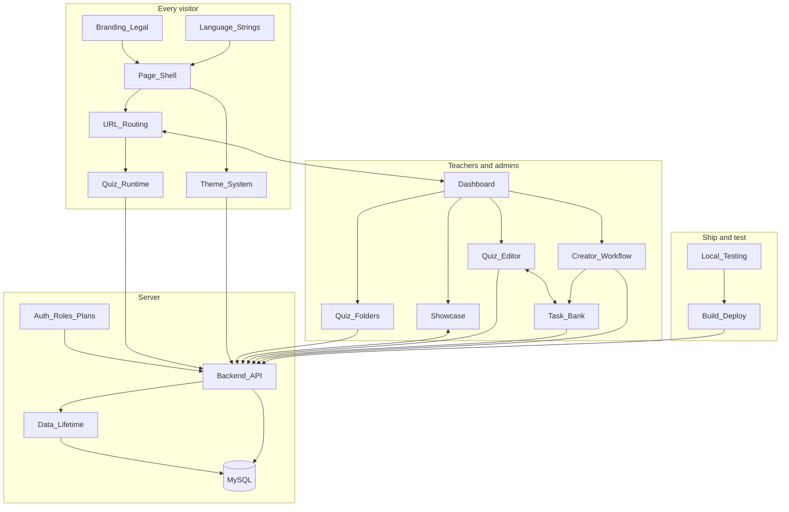

# Quizleris architecture map

**Agents:** read this page and [[01_STATE]] before searching the code, then open the node for the area you are changing. Each node lists its exact files, so a wide search should rarely be needed.

**Obsidian:** open `docs/brain/` as the vault, not the repository root. The cards in [[architecture.canvas]] use paths from that folder, and a root vault would pull `node_modules` into the graph.

## What this system is

Quizleris is the codebase of a platform for teachers, focused on mathematics for now. The public brand is spresk and the business is UAB Judelta.

- **Browser:** vanilla ES modules in `src/`, copied to `dist/` by `copy-files.js`.
- **Server:** `server.js` runs Express on MySQL, with larger areas split into `src/backend/`. It serves `dist/` and `/api`.
- **Production:** a push to `main` on `devukas-eng/Quizleris` deploys to spresk.eu through Hostinger.

## System map

## Routing / Trigger Table

Find the row that matches the task and read that node before touching code.

| When the task mentions | Start in | Read first | Status |
|---|---|---|---|
| Page layout, loading that shrinks or grows, skeletons, `hidden`, footer position, landing page | `src/index.html`, `src/app.js`, `src/style.css` | [[Page_Shell]] | active |
| `?dashboard=`, `?quiz=`, stale addresses, shared links, the back button | `src/url-state.js` | [[URL_Routing]] | active |
| Themes, the theme store, custom colours, premium sync | `src/theme-picker.js`, `src/theme-sync.js` | [[Theme_System]] | active |
| Any Lithuanian or English interface text | `src/lang.js` | [[Language_Strings]] | active |
| Dashboard window, My quizzes, admin tabs, users, invites, the results screen | `src/dashboard-ui.js`, `src/dashboard.js` | [[Dashboard]] | needs-refactor |
| All quizzes, quiz folders, admin quiz search | `src/backend/quiz-folders.js`, `src/admin-quiz-browser.js` | [[Quiz_Folders]] | active |
| Showcase, the landing code board, ticker effects, playlists | `src/code-ticker.js`, `src/admin-showcase.js` | [[Showcase]] | active |
| Creating or saving a quiz, drafts, the quiz limit, lost quizzes | `src/quiz-editor.js` | [[Quiz_Editor]] | active |
| Students joining, playing, grading, quit tracking | `src/render.js`, `src/state.js` | [[Quiz_Runtime]] | active |
| Task bank, teacher access, topics, stars, nicknames, tags, approvals | `src/bank-workspace.js`, `src/backend/bank.js` | [[Task_Bank]] | wip |
| Sending tasks to the bank, approvals, unsorted tasks, the feed, votes, the bank's log, restoring | `src/bank-send.js`, `src/backend/bank-pool.js`, `src/backend/bank-history.js` | [[Creator_Workflow]] | wip |
| API routes, schema at start, rate limits | `server.js`, `src/api.js` | [[Backend_API]] | needs-refactor |
| Deleting anything, deleted quizzes, restoring, quiz versions, the hourly cleanup, expiry, quiz pictures, which quiz uses which task | `src/backend/quiz-trash.js`, `src/backend/quiz-versions.js`, `src/backend/quiz-links.js` | [[Data_Lifetime]] | active |
| Login, roles, invite codes, free and premium limits | `src/auth.js`, `src/backend/plans.js` | [[Auth_Roles_Plans]] | active |
| Business name, copyright, legal pages, cookie text | `src/index.html`, `src/app.js`, `tests/branding.test.js` | [[Branding_Legal]] | wip |
| Build, deploy, checking what is live | `copy-files.js`, `AGENTS.md` | [[Build_Deploy]] | active |
| Running locally, tests, lint, browser pane problems, `/sync-brain`, the brain check | `.claude/launch.json`, `vitest.config.js`, `scripts/check-brain.js` | [[Local_Testing]] | active |

## Rules that apply everywhere

- Every production push needs the owner's explicit OK, because a push to `main` deploys. See [[Build_Deploy]].
- Never start the app with the repository `.env`: it points at the live database. See [[Local_Testing]].
- Never stage `.claude/launch.json`: it holds local database credentials. `.gitignore` covers it, and only `.claude/commands/` is tracked.
- New UI fades in and never changes size to appear. See [[Page_Shell]].
- The owner tests only as admin, so test teacher work as a real teacher. See [[Local_Testing]].
- Nothing is deleted because its parent cannot be found. See [[Data_Lifetime]].

Larger decisions and their reasons are kept in `docs/adr/`.

## Keeping this map true

Run `/sync-brain` after finishing a feature. It updates the affected nodes, [[01_STATE]] and [[architecture.canvas]], then runs the check in `scripts/check-brain.js`. The steps are in `.claude/commands/sync-brain.md`.
